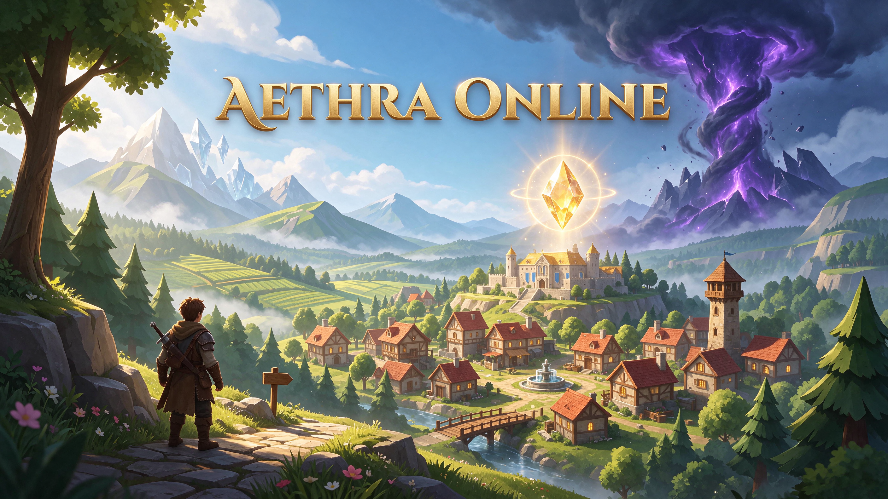
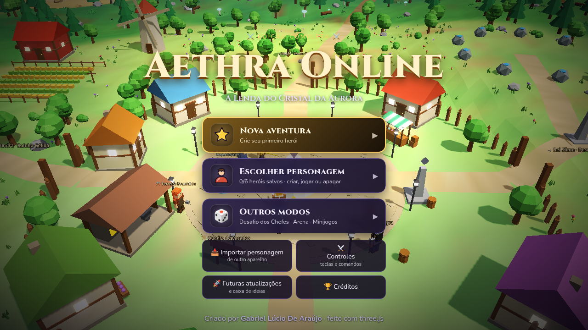

# Aethra Online

> RPG 2.5D de exploração, evolução e aventura criado por [Gabriel Lúcio de Araújo](https://github.com/gabrielaraujo-eng).

<p align="center">
  <a href="https://gabriel-lucio-arcade-c27ec.web.app/arcade/jogos/rpg/">
    
  </a>
</p>

<p align="center">
  <a href="https://gabriel-lucio-arcade-c27ec.web.app/arcade/jogos/rpg/">
    
  </a>
</p>

<p align="center"><strong><a href="https://gabriel-lucio-arcade-c27ec.web.app/arcade/jogos/rpg/">▶ Jogar Aethra Online</a></strong></p>

**Aethra Online** é uma aventura de navegador ambientada em um reino ameaçado pelo Abismo. Crie seu herói, explore a Vila de Aethra e suas regiões, converse com personagens, cumpra missões, evolua habilidades, equipe itens e enfrente os guardiões do Cristal da Aurora.

## Jogar

- **[Ver o código no GitHub](https://github.com/gabrielaraujo-eng/aethra-online)**
- **[Abrir no Arcade Gabriel](https://gabriel-lucio-arcade-c27ec.web.app/arcade/jogos/rpg/)**
- **[Ver o catálogo de jogos do Arcade](https://gabriel-lucio-arcade-c27ec.web.app/jogos/?id=rpg)**

A versão integrada ao Arcade é identificada como **RPG 2.6.3** e aparece no catálogo como **Aethra Online**.

## O que foi melhorado nesta separação

Esta versão foi organizada como um projeto independente a partir da versão publicada do RPG, sem misturar os arquivos de planejamento do Arcade. Além da documentação própria, foram ajustados:

- título, descrição, autoria e URL canônica para o novo repositório;
- metadado de tema para melhor integração com navegadores e dispositivos móveis;
- documentação de controles, salvamento, compatibilidade e arquitetura;
- workflow pronto para publicação no GitHub Pages;
- links claros entre o RPG, o Arcade Gabriel e o portfólio do autor.

O jogo continua preservando as funcionalidades existentes: criação de personagem, campanha principal, Arena Infinita, Desafio dos Chefes, inventário, equipamentos, habilidades, missões, conquistas, minijogos, configurações, salvamento local e exportação/importação de personagem.

## Controles

| Ação | Teclado e mouse | Touch |
| --- | --- | --- |
| Movimento | `WASD` ou clique no chão | joystick virtual |
| Câmera | arrastar com o botão direito | arrastar na tela |
| Interagir | `E` | botão/ação na interface |
| Ataque e habilidades | teclas exibidas na barra inferior | botões na tela |
| Menus | `Esc` e botões do HUD | botões do HUD |
| Conversa | `Enter` | toque nas opções |

O jogo adapta a qualidade gráfica e os controles quando detecta uma tela touch. Para áudio, é necessário permitir a interação inicial do navegador.

## Rodar localmente

O projeto não precisa de build nem de dependências instaladas. Sirva a pasta por HTTP para que os módulos e os recursos do navegador funcionem normalmente:

```bash
python3 -m http.server 8000
```

Depois abra <http://localhost:8000>.

Também é possível usar qualquer servidor estático, como o Live Server do VS Code. Abrir o arquivo diretamente com `file://` pode limitar alguns recursos do navegador.

## Stack

- HTML, CSS e JavaScript no mesmo arquivo para facilitar a distribuição;
- [Three.js r128](https://threejs.org/) para o mundo 3D, câmera, iluminação e pós-processamento;
- Google Fonts — Cinzel e Nunito;
- `localStorage` para configurações e slots de personagem;
- `postMessage` para enviar o nível do jogador ao Arcade quando incorporado em um `iframe`.

O jogo é uma experiência client-side. Não há backend próprio neste repositório e nenhum dado pessoal é enviado pelo jogo de forma independente.

## Estrutura

```text
.
├── index.html                 # jogo completo e autocontido
├── README.md                  # documentação do projeto
└── .github/workflows/pages.yml # publicação no GitHub Pages
```

## Privacidade e dados locais

Os personagens, configurações e progresso ficam no armazenamento local do navegador. Use **Exportar personagem** dentro do jogo para gerar um código de backup e **Importar personagem** para restaurá-lo em outro navegador. Limpar os dados do site pode apagar os slots locais.

Quando o RPG é aberto pelo Arcade, o jogo envia apenas o resultado de pontuação previsto pela integração (`arcade:result`) e o snapshot de salvamento (`arcade:save`) para a janela pai. A origem é validada pelo ambiente do Arcade antes de persistir os resultados.

## Roadmap

- separar CSS e JavaScript em módulos menores sem alterar a experiência atual;
- adicionar testes de fumaça para a abertura, criação de personagem e salvamento;
- revisar o carregamento das dependências CDN e oferecer uma estratégia offline;
- melhorar acessibilidade de menus, diálogos e indicadores do HUD;
- adicionar uma página de changelog para as próximas versões.

## Projetos relacionados

- [GotaVértice](https://github.com/gabrielaraujo-eng/GotaVertice) · [aplicação](https://gotavertice-gj.web.app/apresentacao/)
- [Arcade Gabriel](https://github.com/gabrielaraujo-eng/arcade-site) · [abrir arcade](https://gabriel-lucio-arcade-c27ec.web.app/)
- [Portfólio de projetos](https://github.com/gabrielaraujo-eng/projetos)

## Créditos

Criado por **Gabriel Lúcio de Araújo**. A versão publicada no Arcade Gabriel é a referência funcional desta separação. Os créditos e links do autor também estão disponíveis dentro do jogo.
